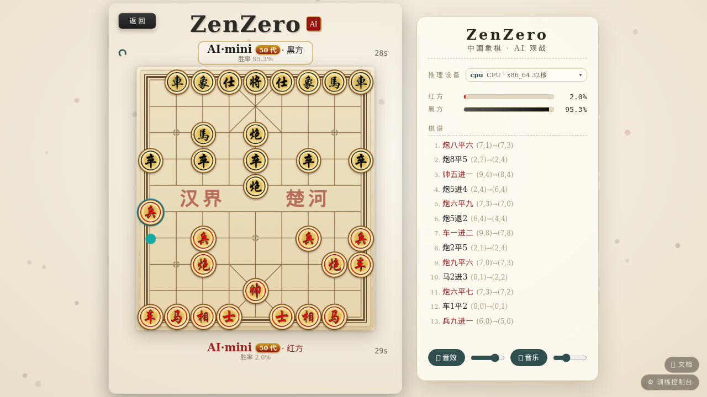
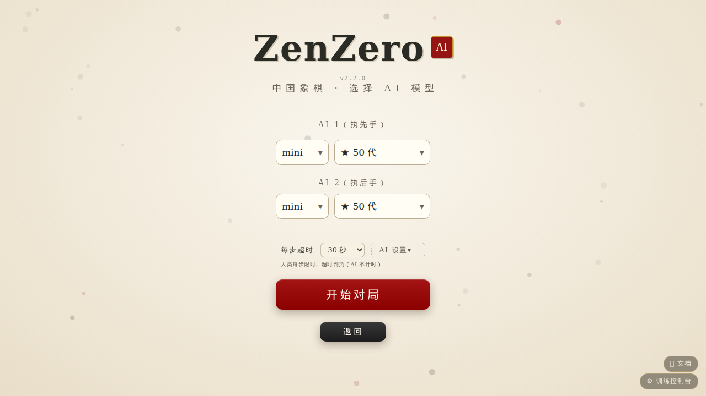
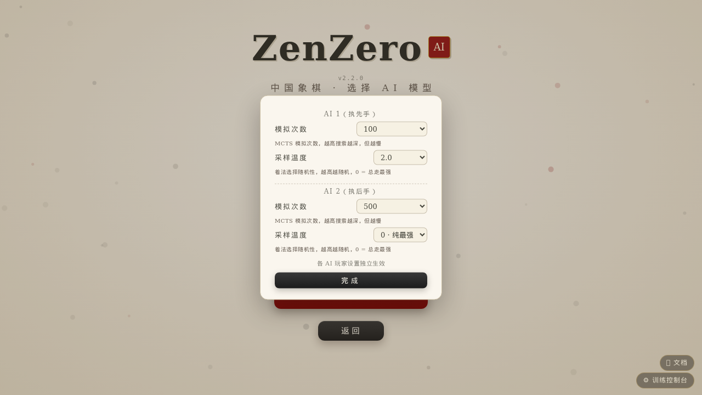
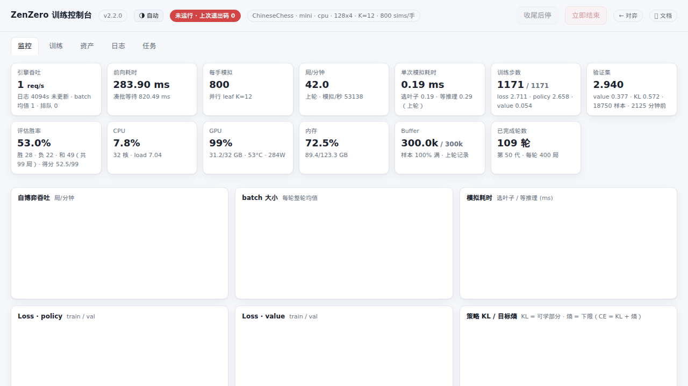

# ZenZero · A High-Performance AlphaZero Framework for Board Games

[**中文**](readme.md) ｜ **English**

A general AlphaZero framework for board games, currently supporting **Chinese Chess (Xiangqi)** and **Gomoku (Five-in-a-Row)**. Python 3.14 free-threading (nogil) + a Cython core + dynamic batched inference take the whole loop — *self-play data generation → training → challenger promotion* — down to a single machine, fully playable from the web.

> 📖 **Docs**: <https://yadiel-tien.github.io/ZenZero/> (six chapters · Chapter 1 “How to Use” gets you running · an [English edition](docs/en/index.html) of the overview and Chapter 1 is available)



## Highlights

- **Truly parallel self-play** — dozens of MCTS threads run across CPU cores, unshackled from the GIL.
- **High-throughput inference engine** — dynamic batching with an adaptive collection window; CPU mode runs multiple parallel workers (default `cores/4`, overridable via `ZZ_INFER_WORKERS`); on an i9-14900K, 8 concurrent games measure +54% over a single worker. Training and playing share one process — queue communication, zero sockets, zero pickling.
- **Cython-accelerated core** — move generation, legality checks and five-in-a-row detection are C-grade, roughly 30× faster search; falls back to pure Python automatically when `.so` files are missing.
- **One process, every entry point** — `python main.py` serves the web game, the training console (`/admin`) and the documentation site (`/docs`).
- **One source of truth for the rules** — human games, self-play and the arena share a single implementation; the browser-side JS rules engine is bit-for-bit aligned with `core/env` action encoding, guaranteed by snapshot-level differential tests.

## Quick start

**1. Environment** ([uv](https://docs.astral.sh/uv/) recommended, one `.venv`, dependency-free frontend):

```bash
uv venv -p cpython-3.14t .venv          # no 3.14t? use -p 3.14 — only multi-thread throughput suffers
source .venv/bin/activate
uv pip install -r requirements-backend.txt --extra-index-url https://download.pytorch.org/whl/cu132
```

**2. Model weights** (optional — strong play without training): grab `.pt` files from [Releases](https://github.com/yadiel-tien/ZenZero/releases); the highest iteration number is always taken as best:

```text
data/ChineseChess/   # e.g. checkpoint_498.pt
data/Gomoku/         # e.g. checkpoint_141.pt
```

**3. Run**:

```bash
python main.py                          # 127.0.0.1:5000 by default; --host 0.0.0.0 exposes the LAN
```

Open `http://<host>:5000/` to play, `/admin` to manage training.

## Playing

Three picks to start a game: game → mode (human vs AI / two players one screen / AI-vs-AI spectate) → model. Model selection is a two-level cascade: first the **network** (s/m/l plus custom names), then the **iteration** within it.



Before the game you can tune:

- **Per-move clock** (30–300 s, default 100 s): humans flagged for time, the AI never.
- **AI settings** popover: per-AI **simulation count** (MCTS depth) and **sampling temperature** (move randomness; 0 = always strongest).



The board is procedurally drawn ink-wash SVG, with Chinese-style notation (炮八平五), dual win-rate bars, thinking animations and full sound; the ⋯ menu offers **undo** (pair-wise in human games) and **resign**. Phones and tablets on the same network just visit the URL. Two-player mode is purely local and works without the AI service. If the GPU runs out of memory the backend drops to CPU inference — still perfectly playable.

## Training

Recommended via the console: `/admin` → Training tab — review game / network / parameters, one click start/stop. The Monitor tab streams throughput, loss, policy KL, win rate and hardware curves; Assets manages checkpoints, experience pools and run dirs; Tools hosts piskvork (Gomocup protocol server), batch sweeps and the Cython builder; arena matches start from the Arena tab.



Bare command (equivalent to the console, single process):

```bash
python -X gil=0 -m scripts.train_server
```

Keep `-X gil=0`: the first forward lazily imports triton and would re-enable the GIL; with it off, multi-threaded MCTS is only pretending. The three stop semantics (stop-after-round / graceful / kill now) are detailed in docs §5.

Cython build (optional, big search speedup):

```bash
python scripts/build_cython.py            # staged compile + atomic swap — safe even mid-training
python scripts/build_cython.py --check    # verify existing .so files only
```

## Device support

`auto` by default: `CUDA > XPU > MPS > DirectML > NPU > CPU`; pin manually with `ZZ_DEVICE=cuda:0 / mps / cpu`. An explicitly requested unavailable device fails loudly — no silent slowdowns.

| Device | torch install | Training | Playing |
| :--- | :--- | :--- | :--- |
| NVIDIA | `--index-url .../whl/cu132` | ★★★★★ | ★★★★★ |
| AMD ROCm / Intel Arc | `.../whl/rocm6.4` / `.../whl/xpu` | ★★★★ | ★★★★★ |
| Apple silicon (MPS) | PyPI default | ★★ | ★★★★ |
| CPU only | PyPI default | ★ | ★★★ (workers fill all cores) |

Checkpoints are device-portable: weights trained on NVIDIA play fine on a Mac or CPU.

## Other ways to play

```bash
python -m scripts.cli_play              # terminal match, in-process engine
python -m scripts.piskvork_server      # Gomocup protocol (Piskvork GUI compatible, port 12345)
python -m scripts.arena                 # ELO ladder (write candidate iterations into data/<Game>/rates/candidates.txt)
```

## Project layout

```text
ZenZero/
├── core/        # environments, MCTS, networks, players (env/mcts/network/player/utils)
├── services/    # inference engine, training, console, monitoring
├── apps/        # web frontends (game/console) and assets, zero build step
├── docs/        # documentation site (static HTML design articles) + English edition (docs/en/)
├── scripts/     # entry points and build tools
├── tests/       # regression suites (13, no external framework)
└── data/        # models, experience pools, game records, ELO data
```

## Documentation (docs/)

Six chapters — a getting-started manual plus five design articles. Read them in a browser or at `http://<host>:5000/docs/` (English edition: `docs/en/`):

| Chapter | Contents |
| :--- | :--- |
| [§1 How to Use](docs/en/usage.html) | three-step quick start, install & build, console, troubleshooting, tests ([中文](docs/usage.html)) |
| [§2 ChineseChess Environment](docs/xiangqi-env.html) | state encoding, 2086-action ABI, legal-move rule engine, 26-plane representation, feature epochs |
| [§3 MCTS & Virtual Loss](docs/mcts.html) | PUCT, batched virtual loss, barrier-free pipeline, π & temperature, measured 5.8k→60k req/s |
| [§4 Inference Engine](docs/inference-engine.html) | four-stage thread pipeline, adaptive batching, symmetry augmentation, device consistency, multi-model hub |
| [§5 Training Pipeline](docs/training.html) | the big loop, sims ramp, holdout set, CE = KL + entropy, stop semantics |
| [§6 Architecture & APIs](docs/architecture.html) | process topology, repo tour, full env-var table, play/console API contracts |

> **Feature epoch 2 (2026-10)**: Xiangqi rules upgraded to the official code (moving into check is illegal; checkmate and stalemate are losses; draw by threefold repetition; perpetual check loses; 120-move clock) and the board representation re-laid out to 26 planes. Old models keep playing under their birth epoch; after the switch training resumes from a fresh network automatically. Regression: `tests/test_chess_rules.py` (21 checks).

## Adding a new game

1. **Environment**: subclass `BaseEnv` in `core/env/env.py`.
2. **Config**: add a `GameConfig` in `core/utils/config.py`.
3. **Frontend**: implement the web UI under `apps/web/`, porting the rules engine to JS with bit-level parity (see the differential-testing constraints in `apps/web/js/env-chess.js`).

## License

[MIT License](LICENSE)
