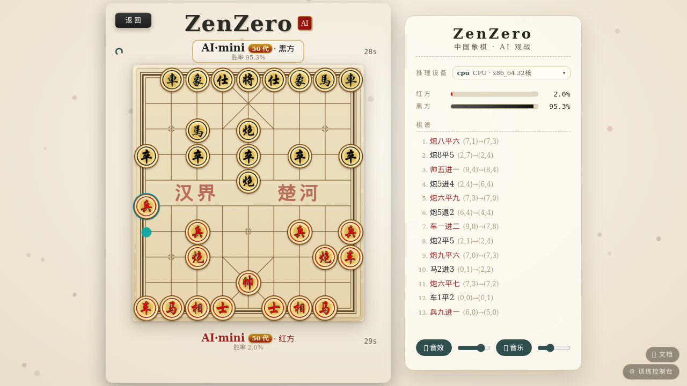
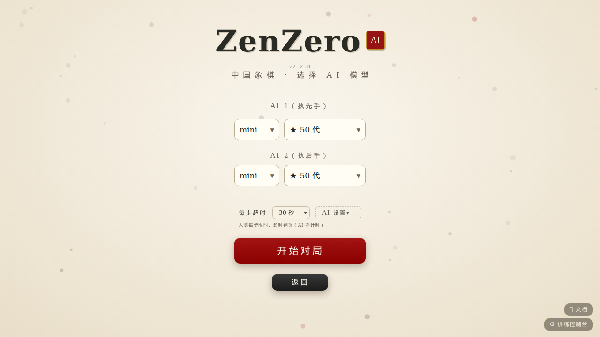
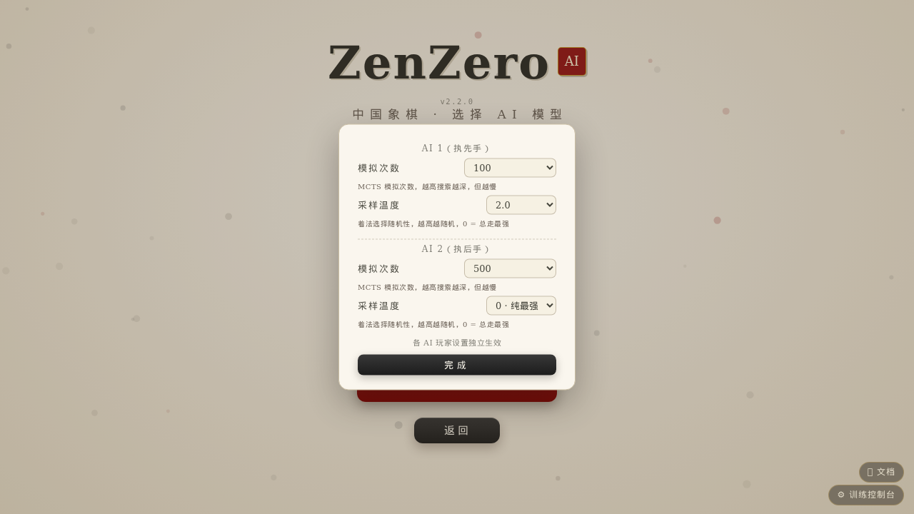
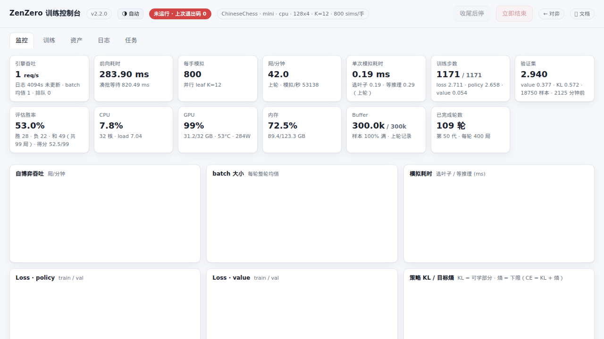

# ZenZero · 高性能 AlphaZero 棋类 AI 框架

[**中文**](readme.md) ｜ [English](README_en.md)

基于 AlphaZero 的通用棋类 AI 框架，当前支持**中国象棋**与**五子棋**。用 Python 3.14 free-threading（nogil）+ Cython 核心 + 动态批量推理，把"自博弈生成数据 → 训练 → 守擂晋升"整条闭环做到单机可跑、网页可玩。

> 📖 **在线文档**：<https://yadiel-tien.github.io/ZenZero/>（六篇 · 第 1 篇《如何使用》上手 · 总览与第 1 篇有 [English 版](docs/en/index.html)）



## 核心亮点

- **真并行自博弈** — 数十个 MCTS 线程跑在不同 CPU 核上，不受 GIL 限制。
- **高吞吐推理引擎** — 动态批处理 + 自适应凑批窗口；CPU 模式多 worker 并行（默认 `核数/4`，`ZZ_INFER_WORKERS` 可覆盖），i9-14900K 实测 8 局并发较单 worker 吞吐 +54%。训练与对战全部进程内队列通信，无 socket / pickle 开销。
- **Cython 加速核心** — 走法生成、合法性检查、五子连珠判定为 C 级实现，搜索提速约 30 倍；缺 `.so` 自动回退纯 Python。
- **一个进程的全部入口** — `python main.py` 同时提供 Web 对战、训练控制台（`/admin`）与文档站（`/docs`）。
- **规则单一事实源** — 人机、自博弈、竞技场共用同一份判定；浏览器 JS 棋规引擎与 `core/env` 动作编码逐位对齐，随机对局快照级对拍测试保障。

## 快速开始

**1. 装环境**（需 [uv](https://docs.astral.sh/uv/)，单一 `.venv`，前端零依赖）：

```bash
uv venv -p cpython-3.14t .venv          # 无 3.14t 用 -p 3.14，仅多线程吞吐受损
source .venv/bin/activate
uv pip install -r requirements-backend.txt --extra-index-url https://download.pytorch.org/whl/cu132
```

**2. 放模型权重**（可选，不训练也想下强棋）——从 [Releases](https://github.com/yadiel-tien/ZenZero/releases) 下载 `.pt`，系统自动取编号最大者：

```text
data/ChineseChess/   # 如 checkpoint_498.pt
data/Gomoku/         # 如 checkpoint_141.pt
```

**3. 启动**：

```bash
python main.py                          # 默认 127.0.0.1:5000；--host 0.0.0.0 开放局域网
```

浏览器打开 `http://<主机>:5000/` 即可对战，`/admin` 管理训练。

## 对战

三步开局：选棋种 → 选模式（人机 / 双人同屏 / AI 观战）→ 选模型。模型选择为两级级联：先**神经网络**（s/m/l 及自定义命名），再该网络下的**模型代数**。



开局前可调：

- **每步超时**（30–300s，默认 100s）：人类每步限时，超时判负，AI 不计时。
- **AI 设置**浮层：每个 AI 玩家独立配置**模拟次数**（MCTS 搜索深度）与**采样温度**（着法随机性，0 = 总走最强）。



对局界面：程序化绘制的水墨风棋盘（SVG）、中文记谱（炮八平五式）、双方胜率条、AI 思考动效、全套音效；⋯ 菜单提供**悔棋**（人机模式成对回退）与**认输**。手机 / 平板同网段直接访问。

双人同屏模式纯本地运行，不依赖 AI 服务。显存不足时后端自动降级 CPU 推理，界面照常可玩。

## 训练

推荐走控制台：`/admin` → 训练页，核对棋种 / 神经网络 / 参数后一键启停；监控页实时吞吐、Loss、策略 KL、胜率与硬件曲线；资产页管理 checkpoint、经验池与运行目录；工具页托管 piskvork（Gomocup 协议服）/ 批扫描 / Cython 构建；竞技场对局在「竞技场」页发起。



裸命令（与控制台等价，单进程）：

```bash
python -X gil=0 -m scripts.train_server
```

`-X gil=0` 必须保留：首次 forward 惰性导入 triton 会试图重开 GIL，强制关闭后多线程 MCTS 才真并行。三种停止语义（收尾后停 / 优雅停止 / 立即结束）详见文档 §5。

Cython 模块编译（可选，显著提升搜索速度）：

```bash
python scripts/build_cython.py            # 暂存编译 + 原子替换，训练在跑也安全
python scripts/build_cython.py --check    # 只检查现有 .so
```

## 设备支持

默认 `auto` 探测：`CUDA > XPU > MPS > DirectML > NPU > CPU`；手动 `ZZ_DEVICE=cuda:0 / mps / cpu`。显式指定不可用会直接报错，防止静默降速。

| 设备 | torch 安装 | 训练 | 对战 |
| :--- | :--- | :--- | :--- |
| NVIDIA | `--index-url .../whl/cu132` | ★★★★★ | ★★★★★ |
| AMD ROCm / Intel Arc | `.../whl/rocm6.4` / `.../whl/xpu` | ★★★★ | ★★★★★ |
| Apple M 系 (MPS) | PyPI 默认 | ★★ | ★★★★ |
| 纯 CPU | PyPI 默认 | ★ | ★★★（多 worker 吃满多核） |

模型 checkpoint 跨设备通用：NVIDIA 上训好的权重可直接在 Mac / CPU 上对战。

## 其它玩法

```bash
python -m scripts.cli_play              # 终端对战，进程内自带引擎
python -m scripts.piskvork_server      # Gomocup 协议（Piskvork GUI 可连，默认端口 12345）
python -m scripts.arena                 # ELO 天梯（data/<Game>/rates/candidates.txt 写候选代数）
```

## 项目结构

```text
ZenZero/
├── core/        # 环境、MCTS、网络、玩家 (env/mcts/network/player/utils)
├── services/    # 推理引擎、训练、控制台、监控
├── apps/        # Web 前端（对战/控制台）与资源，零构建
├── docs/        # 文档站（静态 HTML + 设计文章）
├── scripts/     # 入口脚本与构建工具
├── tests/       # 回归套件（13 套，无外部框架）
└── data/        # 模型、经验池、棋谱、ELO 数据
```

## 文档（docs/）

六篇设计文章 + 使用手册，浏览器直接打开或经 `http://<主机>:5000/docs/`：

| 篇 | 内容 |
| :--- | :--- |
| [§1 如何使用](docs/usage.html) | 三步上手、安装构建、控制台、排障、测试验收（[English](docs/en/usage.html)） |
| [§2 象棋环境](docs/xiangqi-env.html) | 状态编码、2086 动作 ABI、合法着法制规则引擎、26 面棋盘表示、feature epoch |
| [§3 MCTS 与虚拟损失](docs/mcts.html) | PUCT、批量虚拟损失、无屏障流水线、π 与温度、实测 5.8k→60k req/s |
| [§4 推理引擎](docs/inference-engine.html) | 四段线程流水、自适应凑批、镜像增强、设备一致性、多模型 Hub |
| [§5 训练管线](docs/training.html) | 大闭环、sims 爬坡、留出集、CE = KL + 熵、停止语义 |
| [§6 架构与 API](docs/architecture.html) | 进程拓扑、目录导读、环境变量全表、对战/控制台 API 契约 |


> **feature epoch 2（2026-10）**：象棋规则升级为官方口径（送将非法、将死/困毙判负、三次重复判和、长将判负、120 步时钟），棋盘表示重排为 26 面。旧模型按出生 epoch 继续可对战；epoch 切换后训练自动从新网络开训。回归验证：`tests/test_chess_rules.py`（21 项）。

## 接入新游戏

1. **环境**：继承 `core/env/env.py` 的 `BaseEnv`。
2. **配置**：在 `core/utils/config.py` 定义 `GameConfig`。
3. **前端**：在 `apps/web/` 实现网页界面，棋规引擎同步移植为 JS（参考 `apps/web/js/env-chess.js` 的对拍约束）。

## 授权

[MIT License](LICENSE)
